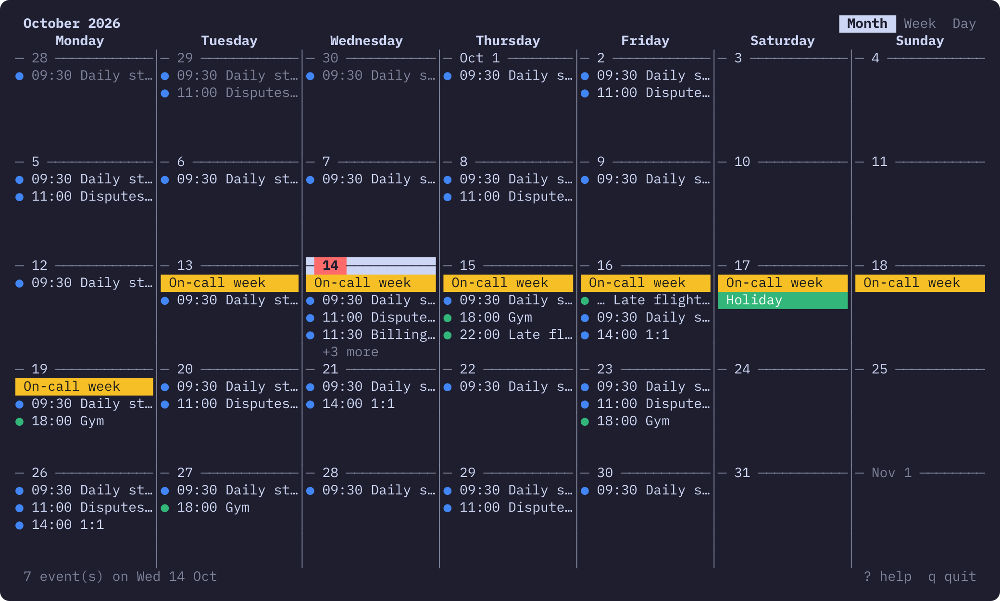
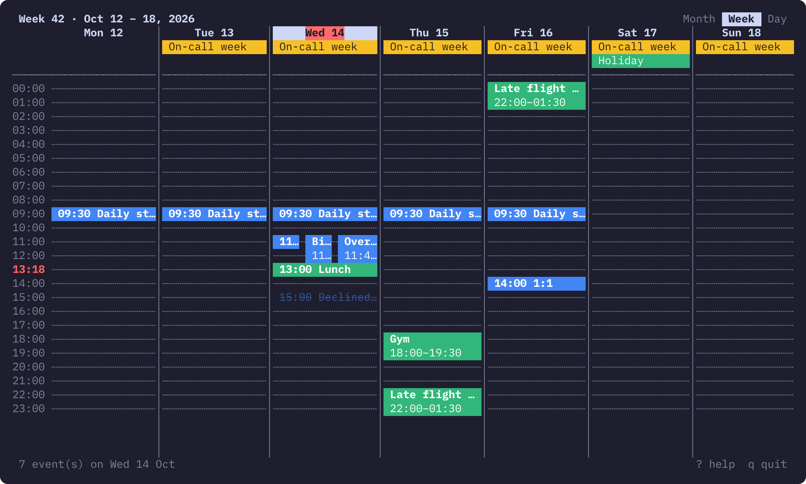

# ktcal

Google Calendar in the terminal (built for kitty, works in any truecolor terminal).
Month / week / day views with vim-style keys. Read-only by default; once you opt in to
editing: quick add, a full event form, delete, and replying to invitations.




## Install

```sh
pnpm install
pnpm build
pnpm add -g "link:$PWD"   # puts `ktcal` on your PATH (pnpm 11; needs `pnpm setup` once)
```

Try it without Google: `ktcal demo` (or `pnpm dev demo`).

## Connect Google (one time)

1. In Google Cloud Console (a project under your Workspace org):
   - enable the **Google Calendar API**;
   - OAuth consent screen: audience **Internal**, add the scope
     `https://www.googleapis.com/auth/calendar.readonly` (and, for editing,
     `https://www.googleapis.com/auth/calendar.events`);
   - Credentials → Create OAuth client → **Desktop app** → Download JSON.
2. Run `ktcal setup` — it picks up the newest `~/Downloads/client_secret_*.json`
   (or pass a path: `ktcal setup ./client.json`), opens the browser for sign-in,
   then lets you choose which calendars to show.
3. Delete the downloaded JSON; ktcal keeps its own copy.

`ktcal calendars` re-picks calendars; `ktcal logout` revokes the token at Google and deletes it.

### Editing (opt-in)

`ktcal setup --edit` signs in again asking for `calendar.events` as well, which enables `a`
(quick add), `n` / `e` (new / edit form), `dd` (delete) and `Y` / `N` / `M` (reply to an
invitation). Running plain `ktcal setup` again goes back to read-only.

- **Quick add** uses Google's own parser (the Calendar "quick add" box) and creates the event on
  your primary calendar. When the cursor isn't on today, `on <that date>` is appended to your text.
- **The form** (`n` on the selected day, `e` on the selected event): title, calendar (←/→,
  new events only), date, all day, start / end, location, guests (emails, comma separated:
  new ones are invited, removed ones get a cancellation; your own entry and rooms are left
  alone), and notes, which open in
  `$VISUAL` / `$EDITOR` (else nvim, else vi). Dates take `today`, `tomorrow`, `+3`, `fri`,
  `20 oct`, `20/10`, …; times take `13:30`, `1330`, `1:30pm`. Moving the start keeps the
  duration. A preview line shows exactly what will be saved. `Tab` / `↑` `↓` move between
  fields (readline keys work inside them: `Ctrl-a/e/u/k/w`), `Ctrl-s` saves, `Esc` cancels.
  Saving an event with guests emails them. An event changed elsewhere since it was loaded
  isn't overwritten: saving fails and asks you to refresh.
- **Recurring events**: saving (or `dd`) asks which occurrences: `t` this one, `f` this and
  the following ones (the series is split in two, like Google Calendar does; a "10 times"
  series keeps its remaining count), or `a` all of them. Series-wide changes can move the
  time but not the day; moving a whole series to another weekday would mean rewriting its
  repeat rule, so for now that's refused with a message.
- **Delete** asks first (for a recurring event: which occurrences) and emails the guests if
  there are any. Events you were invited to can't be deleted: decline them instead.
- **Replies** change only your own RSVP and don't email the organizer.

### What's stored where

Everything lives in `~/.config/ktcal/` (dir `0700`, files `0600`):

| File | Contents |
|---|---|
| `client.json` | the OAuth client (not very secret for Desktop apps, but kept private) |
| `token.json` | access + **refresh token** — a credential: anyone with it can read your calendars until revoked |
| `config.json` | chosen calendars and display settings |

By default ktcal requests only `calendar.readonly`, so a leaked token cannot create, change or
delete anything. With `--edit` it can: a leaked token could then change or delete your events
(not calendar settings or sharing). Revoke it any time with `ktcal logout`, or at myaccount.google.com → Security →
Third-party connections. Nothing else is written to disk; events are cached in memory only.

## Keys

| Key | Action |
|---|---|
| `h` / `l` | previous / next day |
| `j` / `k` | month: next / previous week · week & day: next / previous event |
| `Ctrl-u` / `Ctrl-d`, `[` / `]` | previous / next month, week or day |
| `gg` / `G` | first / last day of the period |
| `0` / `$` | start / end of the week |
| `t` | today |
| `m` / `w` / `d` | month / week / day view |
| `Tab` / `Shift-Tab` | cycle views (month → week → day) forward / back |
| `Enter` | event details (or zoom into the day) |
| `Ctrl-o` | back to the view `Enter` zoomed in from (one level) |
| `o` / `O` | open event in Google Calendar / join its video meeting |
| `1`–`9` | in the details view: open the numbered link (❶ meeting, then links from the location and description; they're also clickable in kitty) |
| `a` | quick add on the selected day, e.g. `Lunch with Dana 1pm` *(editing)* |
| `n` / `e` | new event on the selected day / edit the selected event *(editing)* |
| `dd` | delete the selected event, after a y/n (the first `d` also switches to day view) *(editing)* |
| `Y` / `N` / `M` | accept / decline / maybe an invitation *(editing)* |
| `r` | refresh |
| `Esc` | clear selection / close |
| `q` | close / quit |
| `?` | help |

Motions take a count: `3l`, `2]`, …

## Settings

`~/.config/ktcal/config.json` (created by `ktcal setup`):

```json
{
  "weekStart": 1,        // 1 = Monday … 7 = Sunday
  "dayStart": 8,         // hours always shown in week/day view (events can widen it)
  "dayEnd": 19,
  "refreshMinutes": 5,   // background refresh; 0 = off
  "calendars": [ … ]
}
```

## Development

```sh
pnpm dev            # run from source (tsx)
pnpm dev demo       # …with demo data
pnpm test           # vitest
pnpm typecheck
npx tsx scripts/preview.ts week 140 34   # print a view with demo data, no TTY needed
pnpm screenshots                         # regenerate docs/*.png from demo data (needs rsvg-convert)
```

Layout: `src/views/` render to plain ANSI line arrays through a small cell `Canvas`
(`src/canvas.ts`), so they're pure and tested; `src/app.tsx` is the Ink shell (keys, overlays,
status bar); `src/store.ts` caches events per month and fetches in the background.
